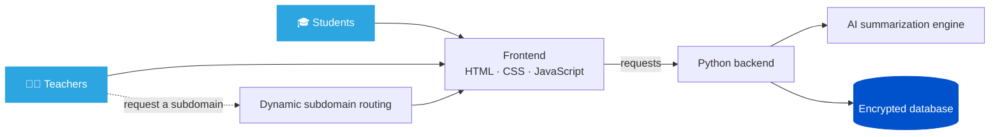

  

  

  

  # Dirasty | دراستي
  ### Iraqi Educational Digitalization Platform
  <b>منصة التحول الرقمي للمناهج الدراسية العراقية</b>

  

    
    
    
    
    
    
  

  

    <a href="#overview">Overview</a> ·
    <a href="#features">Features</a> ·
    <a href="#how-it-works">How it works</a> ·
    <a href="#architecture">Architecture</a> ·
    <a href="#security">Security</a> ·
    <a href="#stack">Stack</a> ·
    <a href="#contributing">Contributing</a> ·
    <a href="#community">Community</a> ·
    <a href="#stats">Stats</a>
  

  <blockquote>
    <b>"Students are the nation's code: today's knowledge engineers, tomorrow's sovereignty."</b> 
    <i>"الطلاب هم الشفرة الوراثية للوطن: معرفة اليوم تُهندس سيادة الغد."</i>
  </blockquote>

---

## 📌 Overview / نبذة

**دراستي (Dirasty)** منصة تعليمية رقمية تحوّل المناهج الدراسية العراقية النصية إلى تجربة تفاعلية، لتمكين الطلبة والمعلمين بأدوات رقمية حديثة.

**Dirasty** turns traditional, text-based Iraqi curricula into an interactive digital experience, giving students and teachers modern tools for learning and teaching.

> **Why Dirasty?** Textbooks carry the knowledge. Dirasty makes it easier to access, understand, and interact with, while staying aligned with the official curriculum.
>
> **لماذا دراستي؟** الكتاب المدرسي يحمل المعرفة، ودراستي تجعلها أسهل وصولًا وفهمًا وتفاعلًا، مع البقاء متوافقة مع المنهج الرسمي.

---

## ✨ Features / المميزات

| Area / المجال | 🎓 Students / الطلبة | 👨‍🏫 Teachers / المعلمون |
| :---: | :--- | :--- |
| 📚 **Content / المحتوى** | Structured guides aligned with official textbooks ملازم منظمة متوافقة مع الكتب الرسمية | Upload summaries and booklets رفع الملخصات والملازم |
| 🤖 **AI / الذكاء الاصطناعي** | Smart summaries of lessons and complex topics تلخيص ذكي للدروس والمواضيع المعقدة | — |
| 🌐 **Identity / الهوية** | — | Request a dedicated subdomain طلب نطاق فرعي خاص بالمعلم |
| 👥 **Management / الإدارة** | — | Manage student groups and content إدارة مجموعات الطلاب والمحتوى |

---

## 🔄 How it works / كيف يعمل

| Step / الخطوة | 🎓 Students / الطلبة | 👨‍🏫 Teachers / المعلمون |
| :---: | :--- | :--- |
| **1** | Open the guide that matches your textbook افتح الملزمة المتوافقة مع كتابك | Upload your summaries and booklets ارفع ملخصاتك وملازمك |
| **2** | Study the interactive lesson content ادرس المحتوى التفاعلي للدرس | Organize students into groups and manage content نظّم الطلبة في مجموعات وأدر المحتوى |
| **3** | Use AI summaries to review complex topics استخدم الملخصات الذكية لمراجعة المواضيع المعقدة | Request a dedicated subdomain for your space اطلب نطاقًا فرعيًا خاصًا بمساحتك |

---

## 🧩 Architecture / البنية

**Request flow.** The frontend sends requests to the Python backend, which calls the AI summarization engine for summaries and reads from and writes to the encrypted database. Teachers can also request a dedicated subdomain, served through dynamic subdomain routing.

**مسار الطلب:** ترسل الواجهة طلباتها إلى الخادم المكتوب بلغة Python، الذي يستعين بمحرك تلخيص الذكاء الاصطناعي، ويقرأ البيانات من قاعدة البيانات المشفّرة ويكتب فيها. ويمكن للمعلمين كذلك طلب نطاق فرعي خاص بهم، يُوجَّه عبر نظام التوجيه الديناميكي للنطاقات الفرعية.

---

## 🛡️ Security / الأمان

- 🔐 **المصادقة:** تسجيل حسابات آمن ودخول محمي للطلبة والمعلمين.
- 🗄️ **البيانات:** قاعدة بيانات مشفّرة، ومسارات الاتصال بها غير مكشوفة.
- 📣 **الإبلاغ المسؤول:** إذا اكتشفت ثغرة أمنية، فيُرجى إبلاغ المشرفين بشكل خاص، وعدم فتح Issue عام أو نشرها في قناة المجتمع.

- 🔐 **Authentication:** Secure sign-up and login for students and teachers.
- 🗄️ **Data:** Encrypted database with protected connection paths.
- 📣 **Responsible disclosure:** If you find a security vulnerability, report it privately to the maintainers. Please do not open a public issue or post it in the community channel.

---

## 🛠️ Stack / التقنيات

| Layer / الطبقة | Technology / التقنية |
| :---: | :--- |
| **Frontend** / الواجهة | HTML5 · CSS3 · Modern JavaScript |
| **Backend** / الخادم | Python |
| **AI** / الذكاء الاصطناعي | LLM-based summarization / تلخيص قائم على نماذج اللغة الكبيرة |
| **Infrastructure** / البنية التحتية | Dynamic subdomain routing · Encrypted database connection |

---

## 🤝 Contributing / المساهمة

الاقتراحات والملاحظات وطلبات السحب مرحب بها. افتح **Issue** أو أرسل **Pull Request**.

Suggestions, bug reports, and pull requests are welcome. Open an **Issue** or send a **Pull Request**.

### Ways to help / طرق المساهمة

| Area / المجال | Ideas / أفكار |
| :--- | :--- |
| 📚 **Content / المحتوى** | Digitize summaries and booklets aligned with official textbooks رقمنة ملخصات وملازم متوافقة مع الكتب الرسمية |
| 🎨 **Interface / الواجهة** | Improve clarity, accessibility, and mobile layouts تحسين الوضوح وإمكانية الوصول والتصميم المتجاوب مع الهواتف |
| ⚙️ **Backend / الخادم** | Improve reliability, security, and performance تحسين الموثوقية والأمان والأداء |
| 🤖 **AI / الذكاء الاصطناعي** | Improve summary quality and accuracy تحسين جودة الملخصات ودقتها |
| 🌍 **Docs / التوثيق** | Keep documentation clear and bilingual إبقاء التوثيق واضحًا وثنائي اللغة |

### How to contribute / خطوات المساهمة

1. Open an **Issue** to discuss larger changes first. افتح **Issue** لمناقشة التغييرات الكبيرة أولًا.
2. Fork the repository and create a focused branch. أنشئ Fork للمستودع، ثم فرعًا مخصصًا للتغيير.
3. Open a **Pull Request** that explains what changed and why. افتح **Pull Request** يشرح ما تغيّر ولماذا.

---

### 📢 Community / المجتمع

انضم لقناتنا لمتابعة آخر التحديثات: 
Join our channel for the latest updates.

---

## 📊 Stats / الإحصائيات

  

  

  

  

---

## 🙏 Acknowledgments / شكر وتقدير

- Flag animation from [allwavingflags.com](https://www.allwavingflags.com/2018/06/flag-of-iraq.html).
- README visuals are generated by third-party services, including shields.io, capsule-render, readme-typing-svg, skillicons.dev, and github-readme-stats.

- تحريك علم العراق من موقع allwavingflags.com.
- صور هذا الملف مُولَّدة بواسطة خدمات خارجية، منها shields.io وcapsule-render وreadme-typing-svg وskillicons.dev وgithub-readme-stats.

---

<i>Dirasty · Built for the Future of Education in Iraq</i> 
دراستي · مستقبل التعليم في العراق

